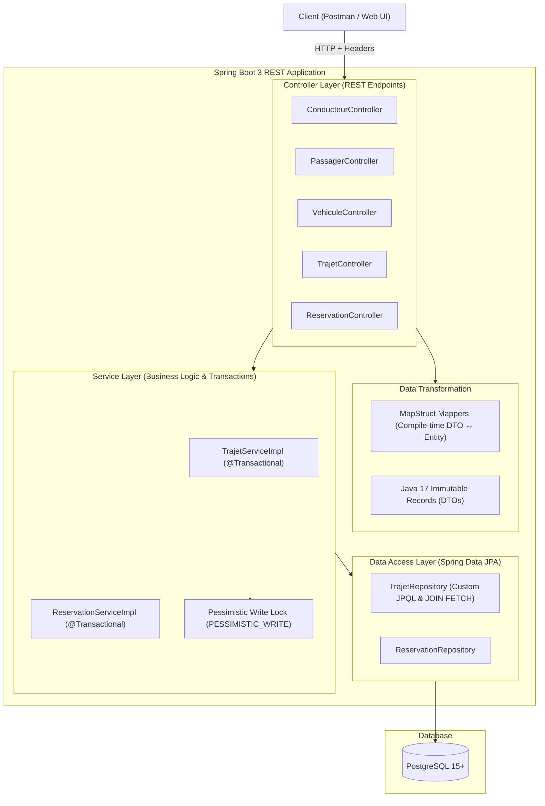
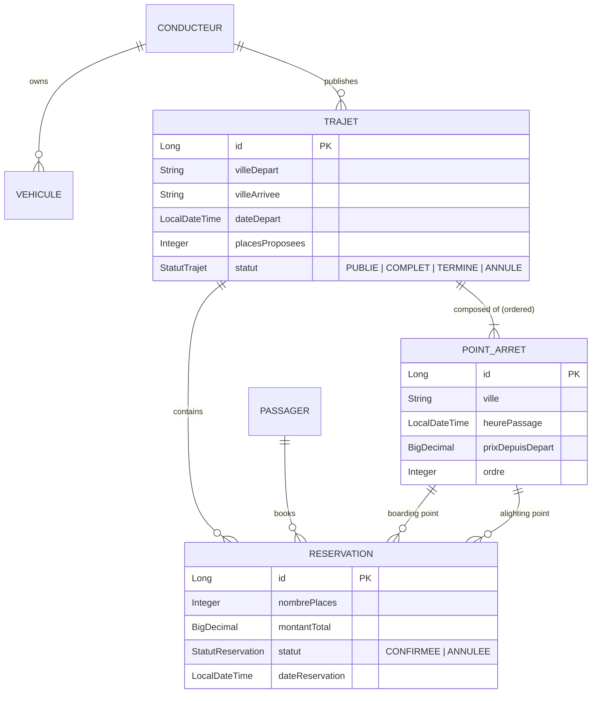

# 🚗 Interurban Multi-Stop Carpooling Platform (API REST)

[](https://www.oracle.com/java/)
[](https://spring.io/projects/spring-boot)
[](https://www.postgresql.org/)
[](https://junit.org/junit5/)
[](http://localhost:8080/swagger-ui/index.html)
[](#architecture--engineering-highlights)

> A production-grade **Spring Boot 3** REST API designed for complex interurban carpooling itineraries with multi-stop segments, concurrency-safe atomic seat booking, and transparent kilometer-based dynamic pricing.

---

## 📌 Executive Summary & Problem Solved

Traditional carpooling platforms force passengers to book entire point-to-point journeys, leaving vehicles with empty seats across intermediate stops on long-haul routes (e.g., *Rabat ➔ Marrakech*).

This platform resolves this inefficiency by treating a journey as an **ordered sequence of stops**:
* **Drivers** publish a single multi-stop trip with progressive timestamps and cumulative pricing.
* **Passengers** search, reserve, and pay exclusively for their exact intermediate segment (e.g., *Casablanca ➔ Settat*).
* **The System** enforces zero double-booking, automatic lifecycle transitions (`PUBLIE` ↔ `COMPLET`), and atomic cascading trip cancellations.

```
[Stop 0: Rabat (17:00) - 0 DH] ──➔ [Stop 1: Casablanca (18:15) - 40 DH] ──➔ [Stop 2: Settat (19:15) - 70 DH] ──➔ [Stop 3: Marrakech (21:30) - 120 DH]
                                  └──────────────── Passenger Segment ────────────────┘
                                              Price: (70 - 40) = 30 DH
```

---

## 💡 Core Architecture & Engineering Highlights

This platform is engineered to address complex challenges in data consistency, database concurrency, and performance optimization within the **Java & Spring Boot** ecosystem.

### 1. High Concurrency & Anti-Overbooking (Pessimistic Locking)
* **Challenge**: When only 1 seat remains, simultaneous reservation requests from multiple users can lead to catastrophic race conditions (overbooking).
* **Solution**: Implemented strict database row-level locking via JPA `@Lock(LockModeType.PESSIMISTIC_WRITE)` (`SELECT ... FOR UPDATE`) inside atomic `@Transactional` service boundaries. 
* **Result**: Concurrent requests are serialized safely at the database level with deterministic outcomes.

### 2. High-Performance SQL & Elimination of the $N+1$ Query Problem
* **Challenge**: Loading a trip and its nested relationships (stops, driver, vehicle, passenger bookings) can easily trigger hundreds of lazy-loading round trips to PostgreSQL ($N+1$ explosion).
* **Solution**: Crafted explicit JPQL queries with `JOIN FETCH` clauses across all read operations (`findDetailById`, `findByPassagerId...`, `findByTrajetId...`).
* **Result**: Complete object graphs are retrieved in a **single round-trip query**, ensuring predictable sub-10ms response times.

### 3. Single-Pass Multi-Criteria Search with Dynamic Availability
* **Challenge**: Searching for available trips between arbitrary intermediate stops requires calculating available seats on-the-fly and validating segment order (`stop_departure.order < stop_arrival.order`).
* **Solution**: Developed a single optimized JPQL query using a correlated subquery `(t.placesProposees - COALESCE(SUM(r.nombrePlaces), 0))` that handles city matching, chronological stop validation, date truncation, and dynamic price difference calculation in one pass with native Spring Data `Pageable` support.

### 4. Zero Data Redundancy & Absolute Consistency (Rule R-33)
* **Architectural Decision**: Neither `placesRestantes` (remaining seats) nor `prixSegment` (segment fare) are stored as physical columns in the database.
* **Why**: Storing derived values leads to cache invalidation bugs and desynchronization when bookings are cancelled or amended. Instead, values are derived in-memory or via SQL aggregate projections, guaranteeing 100% mathematical consistency.

### 5. Time Determinism & Testability (`java.time.Clock`)
* **Challenge**: Testing time-sensitive rules (e.g., cancellation allowed until exactly 24 hours before departure) using `LocalDateTime.now()` makes test suites flaky and reliant on the host's system clock.
* **Solution**: Injected a Spring bean `java.time.Clock`. In test suites, `Clock.fixed(instant, zone)` freezes time, enabling deterministic assertions down to the millisecond.

### 6. Production-Grade Error Standardization (RFC 7807)
* Standardized all API exceptions through a centralized `@RestControllerAdvice` implementing RFC 7807 **`ProblemDetail`**:
  * `400 Bad Request`: Parameter violations, invalid itinerary sequencing (`InvalidRequestException`).
  * `403 Forbidden`: Actor mismatch and unauthorized access (`ForbiddenOperationException`).
  * `404 Not Found`: Missing resource lookups (`ResourceNotFoundException`).
  * `409 Conflict`: Business rule conflicts, deadline expirations, final status changes (`BusinessRuleException`).

---

## 🏗️ Architecture & Tech Stack



### Technology Highlights
* **Core**: Java 17 (LTS), Spring Boot 3.x, Spring MVC, Spring Data JPA.
* **Database**: PostgreSQL, Hibernate 6 ORM.
* **Testing**: JUnit 5, Mockito, AssertJ (105 tests, 100% logic coverage).
* **Code Quality & Utilities**: MapStruct (type-safe compile-time mapping), Project Lombok, OpenAPI 3 (Swagger).

---

## 📊 Domain Model & Entity Relations



---

## 🚀 REST API Endpoints Overview

The API uses lightweight simulation headers (`X-Driver-Id`, `X-Passenger-Id`) to enforce strict role separation and ownership validation.

| Method | Endpoint | Actor Header | Success | Description |
| :--- | :--- | :---: | :---: | :--- |
| **POST** | `/api/drivers` | — | `201` | Register a new driver profile with unique email/license |
| **GET** | `/api/drivers/{id}` | — | `200` | Fetch driver profile details |
| **POST** | `/api/passengers` | — | `201` | Register a new passenger profile |
| **GET** | `/api/passengers/{id}/reservations` | `X-Passenger-Id` | `200` | **F-11**: View passenger booking history (ordered DESC) |
| **POST** | `/api/vehicles` | `X-Driver-Id` | `201` | Add vehicle (capacity 1 to 8 seats) |
| **POST** | `/api/trips` | `X-Driver-Id` | `201` | **F-17**: Publish trip with ordered stops & progressive prices |
| **GET** | `/api/trips/{id}` | — | `200` | **F-18**: Detailed trip view (dynamic remaining seats) |
| **GET** | `/api/trips/{id}/reservations` | `X-Driver-Id` | `200` | **F-19**: Driver views all passenger bookings on their trip |
| **GET** | `/api/trips/search` | — | `200` | **F-20**: Multi-stop search with segment pricing & pagination |
| **PATCH** | `/api/trips/{id}/finish` | `X-Driver-Id` | `200` | **F-23**: Complete trip after departure time (`TERMINE`) |
| **PATCH** | `/api/trips/{id}/cancel` | `X-Driver-Id` | `204` | **F-24**: Cancel trip & cascade cancel all confirmed bookings |
| **POST** | `/api/reservations` | `X-Passenger-Id` | `201` | **F-21**: Book seats (auto-switches to `COMPLET` if 0 seats) |
| **PATCH** | `/api/reservations/{id}/cancel` | `X-Passenger-Id` | `204` | **F-22**: Cancel booking $\ge$ 24h before (auto-reopens to `PUBLIE`) |

---

## 🧪 Testing & Quality Assurance

The codebase is backed by **105 automated unit tests** adhering strictly to the **AAA (Arrange-Act-Assert)** pattern.

```bash
# Run the entire test suite
mvn test
```

### Test Suite Distribution
* **Domain & Business Rule Tests**: Validating itinerary chronologies, stop ordering, capacity bounds, and exact 24-hour cancellation cutoffs.
* **Security & Isolation Tests**: Ensuring drivers/passengers receive `403 Forbidden` when attempting to read or manipulate resources belonging to others.
* **State Machine & Lifecycle Tests**: Verifying deterministic state transitions (`PUBLIE` $\leftrightarrow$ `COMPLET`, `TERMINE`, `ANNULE`).
* **Transactional Rollback Tests**: Simulating partial batch failures to verify zero state corruption upon error.

---

## 🛠️ Quickstart Guide

### Prerequisites
* **Java 17+** (JDK)
* **Maven 3.9+**
* **PostgreSQL 15+** (or Docker)

### 1. Database Setup
Create a PostgreSQL database:
```sql
CREATE DATABASE covoiturage;
```

Configure your credentials in `src/main/resources/application.yml`:
```yaml
spring:
  datasource:
    url: jdbc:postgresql://localhost:5432/covoiturage
    username: postgres
    password: yourpassword
```

### 2. Build & Run
```bash
# Compile and package
mvn clean package -DskipTests

# Run the Spring Boot application
mvn spring-boot:run
```

The application starts at: **`http://localhost:8080`**

### 3. Interactive API Documentation (Swagger)
Open your browser and navigate to:
```
http://localhost:8080/swagger-ui/index.html
```

---

## 👨‍💻 Engineering Standards Applied

* **Clean Architecture & Separation of Concerns**: Strict decoupling between Web, Domain, Persistence, and DTO transfer layers.
* **SOLID Principles**: Single responsibility services, dependency injection via interfaces, and open-closed status state machines.
* **Immutable Contracts**: All DTO requests and responses are modeled as Java 17 `record` types to prevent accidental state mutability.
* **Logging Strategy**: SLF4J structured logging (`INFO` on successful business milestones, `WARN` on rule rejections, `ERROR` on unexpected exceptions).
